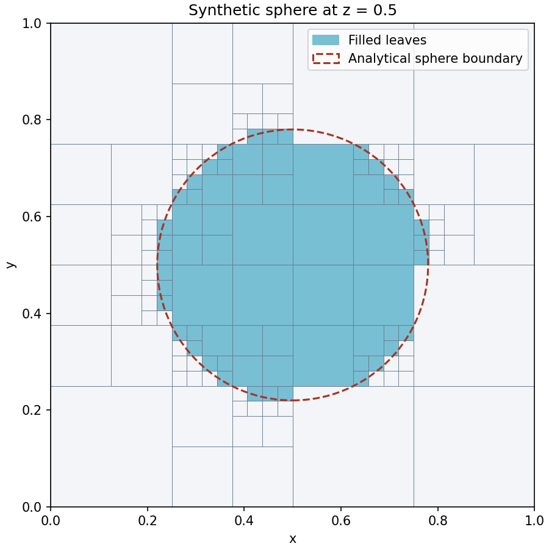

# Octree Macro-Voxel

Approximate a solid with variable-size cubes. The octree keeps large cubes where occupancy is clear and uses finer cubes near interfaces.

## Run the synthetic demo

Use Python 3.10+ and Matplotlib. The voxelizer itself uses the Python standard library.

~~~sh
python -m pip install matplotlib
python demo.py --out-dir build
python -m unittest -v
~~~

Open **build/sphere-slice.png** for a cross-section through a synthetic sphere. **build/octree.json** stores the leaves, their sample fractions and the comparison with the analytical sphere volume.

## Method

This is a standalone implementation of the geometric method in Terry J. Price's September 2017 technical note, *The Octree Macro-Voxel Technique: A Voxel Generation Scheme and its Implementation in Salome and Serpent*.

1. Enclose the solid in a cube and split the cube into eight equal octants.
2. Draw uniform random sample points in each octant. Its hit ratio is the fraction inside the solid.
3. Classify ratios at or below the lower bound as void and ratios at or above the upper bound as solid. Split intermediate octants again.
4. At the maximum depth, classify remaining mixed cubes using the final fill threshold.

The original X-notation is retained as x-separated low/high coordinate triplets such as **111x111**. This version defines threshold ties explicitly, including an inclusive final fill threshold. It accepts a binary point-in-solid function. An analytical sphere supplies that function for the demo. The original SALOME mesh interface, solver encoding, and transport benchmarks are outside the scope of this implementation.

Sampling can miss features smaller than a cube or features with a very low hit probability. The seed makes a run reproducible. Compare volume estimates across sample counts, depths, and seeds for applications where approximation error matters.

## Example output

The default seed produces 2,052 leaves. A uniform grid at the same finest spacing uses 32,768 cells. The estimated sphere volume is 1.43% below the analytical value for this run.
